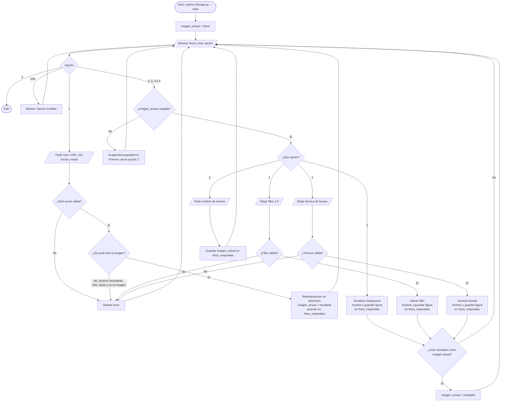

# Proyecto 2: Procesamiento de imágenes y modelos de regresión con Python

**Programación Python Avanzada — Tecnicatura Universitaria en Tecnologías de Programación — 2026**

Integrantes: Sofia Martin, Laura Sofía Pérez Llanqueleo

| Parte | Contenido | Abrir en Colab |
|---|---|---|
| 1. fotoapp | [`parte1_fotoapp/fotoapp.py`](parte1_fotoapp/fotoapp.py) (módulo) y [`fotoapp_testdev.ipynb`](parte1_fotoapp/fotoapp_testdev.ipynb) (pruebas) | [](https://colab.research.google.com/github/SofiMartin/proyecto2-python-avanzado/blob/master/proyecto2-python-avanzado/parte1_fotoapp/fotoapp_testdev.ipynb) |
| 2. Regresión | [`parte2_regresion/regresion_lineal_multiple.ipynb`](parte2_regresion/regresion_lineal_multiple.ipynb) | [](https://colab.research.google.com/github/SofiMartin/proyecto2-python-avanzado/blob/master/proyecto2-python-avanzado/parte2_regresion/regresion_lineal_multiple.ipynb) |

```
proyecto2-python-avanzado/
├── README.md
├── requirements.txt
├── parte1_fotoapp/
│   ├── fotoapp.py                 # módulo con todas las funciones + menú
│   ├── fotoapp_testdev.ipynb      # notebook de pruebas
│   ├── fotos_mejoradas/           # resultados del menú (fotos redimensionadas y figuras)
│   └── imagenes/
│       ├── originales/            # fotos de prueba (+ CREDITOS.md)
│       └── generadas/             # figuras e imágenes generadas
└── parte2_regresion/
    ├── insurance.csv              # dataset
    ├── regresion_lineal_multiple.ipynb
    └── graficos/                  # gráficos generados por el notebook
```

## Cómo ejecutarlo

- **Google Colab:** abrir los notebooks con los botones de arriba y ejecutar todas las celdas. La primera celda clona este repositorio para tener `fotoapp.py`, las imágenes y el dataset. Opcionalmente se puede montar Google Drive para usar fotos propias.
- **Jupyter local:**
  ```bash
  pip install -r requirements.txt
  jupyter notebook
  ```
- **Menú por consola:**
  ```bash
  cd parte1_fotoapp
  python fotoapp.py
  ```

---

## Parte 1: fotoapp

| # | Función | Qué hace |
|---|---|---|
| 1 | `redimensionar_para_red(ruta, red_social, modo="recortar")` | Lee la foto (archivo local, Google Drive o URL) y la lleva al tamaño recomendado de **YouTube (1280×720)**, **Instagram (1080×1080)**, **Twitter/X (1600×900)** o **Facebook (1200×630)** sin distorsionarla. Lo hace recortando centrado (`resize` + `crop`) o ajustando con bandas blancas (`resize` + `paste`). |
| 2 | `ecualizar_histograma(imagen, ruta_figura)` | Ecualiza el histograma con `cv2.equalizeHist` (en fotos color, solo el brillo: canal Y de YCrCb) y muestra/guarda una figura con la foto original, la ecualizada y sus histogramas. Probada con una foto oscura y otra con exceso de luz. |
| 3 | `aplicar_filtro(imagen, filtro, ruta_figura)` | Aplica uno de los 9 filtros de Pillow (por número 1-9 o por nombre) y muestra/guarda la original y la filtrada lado a lado. |
| 4 | `boceto(imagen, tecnica, **parametros)` y `comparar_bocetos(...)` | Boceto de líneas negras sobre fondo blanco con **umbral adaptativo**, **Sobel**, **Laplaciano** o **Canny**. Parámetros ajustables y comparación lado a lado. |
| 5 | `main()` / `menu()` | Menú por consola. Obliga a pasar primero por la función 1 y valida todo con excepciones. Guarda todos los resultados en la carpeta `fotos_mejoradas`. |

**Excepciones propias:** `ImagenNoCargadaError`, `RedSocialInvalidaError`, `FiltroInvalidoError` y `TecnicaInvalidaError`. Todas las funciones de edición llaman a `_validar_imagen()`, que lanza `ImagenNoCargadaError` si todavía no se leyó ninguna imagen. Así el usuario no puede saltearse la lectura.

### Diagrama de flujo del menú



### Resultados destacados

| Ecualización: foto oscura | Ecualización: exceso de luz |
|---|---|
|  |  |


Las fotos de prueba son de Wikimedia Commons. Ver [créditos y licencias](parte1_fotoapp/imagenes/originales/CREDITOS.md).

---

## Parte 2: Regresión Lineal Múltiple

**Dataset:** [Medical Cost Personal Datasets (Kaggle)](https://www.kaggle.com/datasets/mirichoi0218/insurance). Son 1338 personas aseguradas.
**Y (a predecir):** `charges`, el costo médico anual en USD.
**X (features numéricas):** `age` (edad), `bmi` (índice de masa corporal) y `children` (hijos cubiertos).

Pasos del notebook: 1) carga y visualización, 2) paso a estructura matricial (NumPy), 3) partición 80/20 en entrenamiento y test, 4) entrenamiento con `LinearRegression`, 5) evaluación en entrenamiento, 6) evaluación en test. Como extra, se comparan modelos con otras features.

### Resultados

| Modelo | R² train | R² test | MAE test (USD) | RMSE test (USD) |
|---|---|---|---|---|
| **age, bmi, children (modelo pedido)** | **0.110** | **0.155** | **9.181** | **11.454** |
| + smoker | 0.741 | 0.781 | 4.214 | 5.829 |
| todas las variables (+ sex, region) | 0.742 | 0.784 | 4.181 | 5.796 |
| todas + `fumador_obeso` (fumador con IMC ≥ 30) | 0.861 | 0.872 | 2.486 | 4.458 |

### Conclusiones

**¿Cuál fue el desempeño del modelo?**
El modelo con las tres features numéricas (`age`, `bmi`, `children`) tiene un desempeño **pobre**: R² ≈ 0.11 en entrenamiento y ≈ 0.16 en test. Explica solo entre el 11 % y el 16 % de la variabilidad del costo médico y se equivoca en promedio unos 9.000 USD (MAE), cuando el costo promedio es de ~13.000 USD. Además, nunca predice valores altos: subestima sistemáticamente a las personas con costos mayores a ~20.000 USD.

**¿Qué variable fue la más influyente según los coeficientes del modelo?**
Coeficientes: `age` ≈ 221 USD por año, `bmi` ≈ 332 USD por punto de IMC y `children` ≈ 563 USD por hijo. El coeficiente crudo más grande es el de `children`, pero no se puede comparar directamente porque las variables tienen escalas distintas. Con el **efecto estandarizado** (coeficiente × desvío estándar), la variable más influyente es **`age`** (≈ 3.100 USD por cada desvío de ~14 años), seguida por `bmi` (≈ 2.000 USD) y `children` (≈ 700 USD). Coincide con las correlaciones con `charges`: 0.30, 0.20 y 0.07.

**¿Las features extraídas del dataset fueron buenas predictoras? ¿Sugieren otras?**
Por sí solas **no**: tienen una relación positiva pero débil con el costo. En la visualización se ven tres "bandas" de costos para una misma edad, y esas bandas se explican por la variable **`smoker`**. Agregándola, el R² en test sube a ≈ 0.78. `sex` y `region` casi no aportan. La mejora más grande viene de la interacción **fumador con obesidad (IMC ≥ 30)**: el R² en test llega a ≈ 0.87 y el MAE baja a ~2.500 USD, porque el IMC encarece mucho el seguro solo en los fumadores. **Sugerimos usar `smoker` y esa interacción.** Información que no está en el dataset, como enfermedades preexistentes o actividad física, podría mejorar todavía más el modelo.

**Comparativa de resultados con los datos de Entrenamiento y de Test**
En todos los modelos las métricas de entrenamiento y de test son **muy parecidas** (modelo pedido: R² 0.110 vs 0.155, RMSE 11.335 vs 11.454 USD). Por lo tanto **no hay sobreajuste**: el modelo generaliza a datos nuevos igual que a los de entrenamiento. Que el test dé un poco mejor se debe al azar de la partición (268 observaciones en test). El problema del modelo pedido es de **subajuste**: le faltan variables explicativas, no le sobra complejidad.
