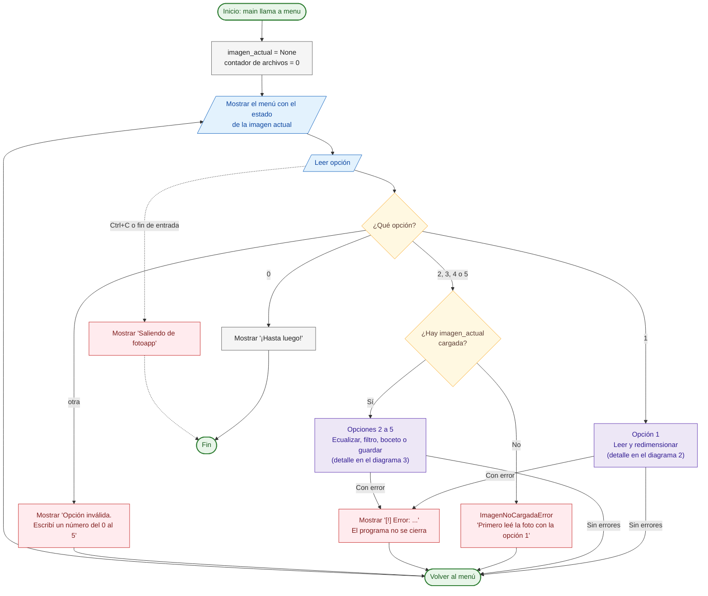
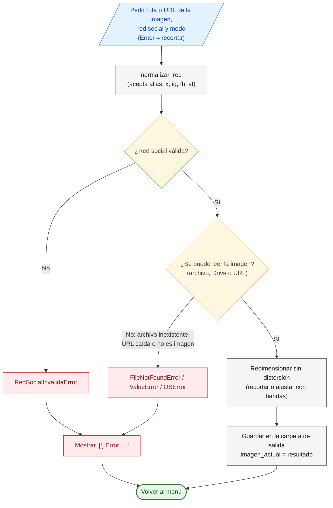
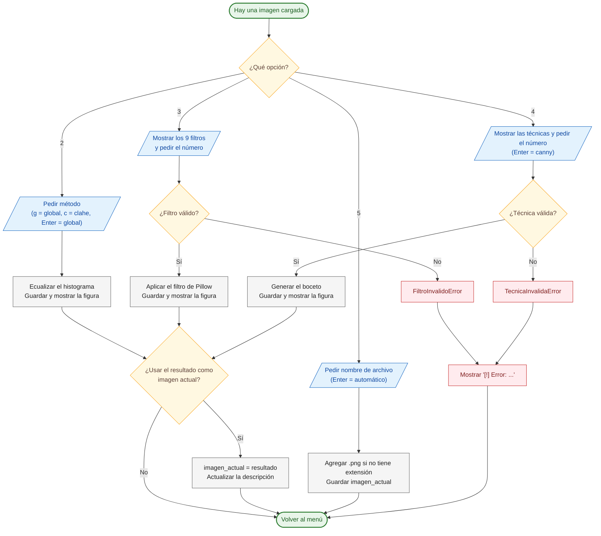
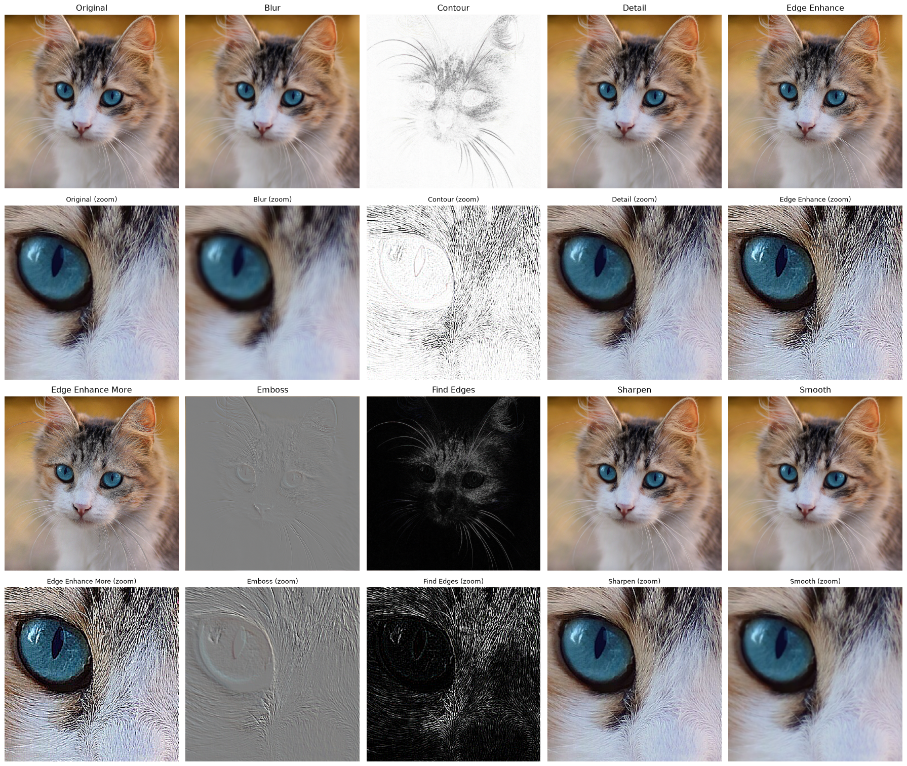
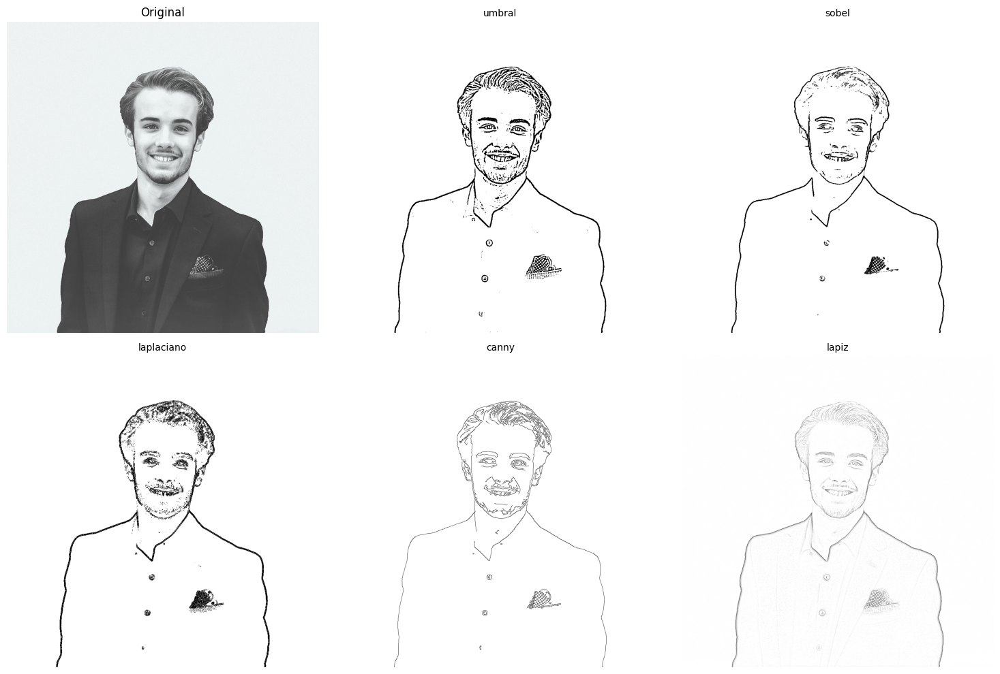

# Proyecto 2: fotoapp, procesamiento de imágenes con Python

**Programación Python Avanzada — Tecnicatura Universitaria en Tecnologías de Programación — 2026**

Integrantes: Sofia Martin, Laura Sofía Pérez Llanqueleo

| Parte | Contenido | Abrir en Colab |
|---|---|---|
| 1. fotoapp | [`parte1_fotoapp/fotoapp.py`](parte1_fotoapp/fotoapp.py) (módulo) y [`fotoapp_testdev.ipynb`](parte1_fotoapp/fotoapp_testdev.ipynb) (pruebas) | [](https://colab.research.google.com/github/SofiMartin/proyecto2-python-avanzado/blob/master/proyecto2-python-avanzado/parte1_fotoapp/fotoapp_testdev.ipynb) |

```
proyecto2-python-avanzado/
├── README.md
├── requirements.txt
├── parte1_fotoapp/
│   ├── fotoapp.py                 # módulo con todas las funciones + menú
│   ├── fotoapp_testdev.ipynb      # notebook de pruebas
│   ├── fotos_mejoradas/           # resultados del menú (fotos redimensionadas y figuras)
│   └── imagenes/
│       ├── originales/            # fotos de prueba (+ CREDITOS.md)
│       └── generadas/             # figuras e imágenes generadas
```

## Cómo ejecutarlo

- **Google Colab:** abrir los notebooks con los botones de arriba y ejecutar todas las celdas. La primera celda clona este repositorio para tener `fotoapp.py`, las imágenes y el dataset. Opcionalmente se puede montar Google Drive para usar fotos propias.
- **Jupyter local:**
  ```bash
  pip install -r requirements.txt
  jupyter notebook
  ```
- **Menú por consola:**
  ```bash
  cd parte1_fotoapp
  python fotoapp.py
  ```

---

## Parte 1: fotoapp

| # | Función | Qué hace |
|---|---|---|
| 1 | `redimensionar_para_red(ruta, red_social, modo="recortar")` | Lee la foto (archivo local, Google Drive o URL) y la lleva al tamaño recomendado de **YouTube (1280×720)**, **Instagram (1080×1080)**, **Twitter/X (1600×900)** o **Facebook (1200×630)** sin distorsionarla. Lo hace recortando centrado (`resize` + `crop`) o ajustando con bandas blancas (`resize` + `paste`). |
| 2 | `ecualizar_histograma(imagen, ruta_figura, metodo="global")` | Ecualiza el histograma con `cv2.equalizeHist` (`metodo="global"`) o con `cv2.createCLAHE` (`metodo="clahe"`, adaptativo por zonas, evita el exceso de contraste). En fotos color, solo el brillo: canal Y de YCrCb y muestra/guarda una figura con la foto original, la ecualizada y sus histogramas. Probada con una foto oscura y otra con exceso de luz. |
| 3 | `aplicar_filtro(imagen, filtro, ruta_figura)` | Aplica uno de los 9 filtros de Pillow (por número 1-9 o por nombre) y muestra/guarda la original y la filtrada lado a lado. |
| 4 | `boceto(imagen, tecnica, **parametros)` y `comparar_bocetos(...)` | Boceto de líneas negras sobre fondo blanco con **umbral adaptativo**, **Sobel**, **Laplaciano** o **Canny**. Parámetros ajustables y comparación lado a lado. |
| 5 | `main()` / `menu()` | Menú por consola. Obliga a pasar primero por la función 1 y valida todo con excepciones. Guarda todos los resultados en la carpeta `fotos_mejoradas`. |

**Imágenes con transparencia:** si la foto es un PNG con transparencia, se pega sobre fondo blanco al leerla (si no, el fondo quedaría negro).

**Mostrar figuras:** el parámetro `mostrar` de las funciones es `None` por defecto: la figura se muestra solo en Jupyter/Colab. Con `True` se muestra siempre y con `False` nunca, por ejemplo al importar el módulo desde un script.

**Excepciones propias:** `ImagenNoCargadaError`, `RedSocialInvalidaError`, `FiltroInvalidoError` y `TecnicaInvalidaError`. Todas las funciones de edición llaman a `_validar_imagen()`, que lanza `ImagenNoCargadaError` si todavía no se leyó ninguna imagen. Así el usuario no puede saltearse la lectura.

### Diagrama de flujo del menú

El flujo se divide en tres diagramas para que se lea bien: el ciclo general del menú, la opción 1 y las opciones 2 a 5. Los colores indican el tipo de paso: verde = inicio o fin, azul = entrada del usuario, amarillo = decisión, gris = proceso, rojo = error o mensaje, violeta = detalle en otro diagrama.

#### 1. Ciclo general



#### 2. Opción 1: leer y redimensionar



#### 3. Opciones 2 a 5: ecualizar, filtro, boceto y guardar



### Resultados destacados

| Ecualización: foto oscura | Ecualización: exceso de luz |
|---|---|
|  |  |





Las fotos de prueba son de Wikimedia Commons. Ver [créditos y licencias](parte1_fotoapp/imagenes/originales/CREDITOS.md).
